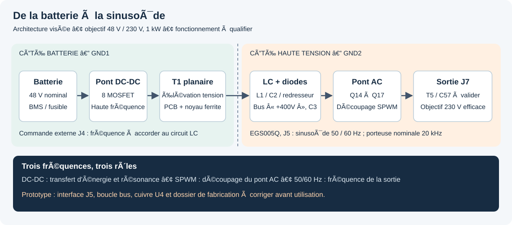

# cirBATTverter — onduleur batterie 48 V / 230 V de cirBATT, objectif 1 kW

Français · [English overview](README.en.md) · [Site officiel cirBATT](https://cirbatt.com/)

Un projet matériel ouvert de [cirBATT](https://cirbatt.com/), à Grenoble, pour transformer l'énergie d'une batterie en courant alternatif utilisable par des appareils électriques. Le cirBATTverter explore la conversion de puissance pour des **batteries lithium de seconde vie** ; cirBATT présente son activité de collecte, requalification et réemploi dans [son parcours de remise en service des batteries](https://cirbatt.com/fonctionnement).

**1 kW désigne une puissance.** L'énergie disponible, en kWh, dépend de la batterie. Le nom historique des fichiers `cirBATTverter_1KWH` ne signifie pas que cette carte contient une batterie de 1 kWh.



## État de cette révision

**Mise à jour du 20 octobre 2026 :** correction Q15 et nouveaux fichiers intégrés. Lire la [vérification actuelle](docs/12-revue-corrections-2026-10-20.md).

**Prototype à revoir avant fabrication ou mise sous tension.** Les fichiers confirment des progrès et des points encore ouverts :

- **Corrections confirmées :** anciennes pistes +15V de J5-17 supprimées, R35 raccordée à +400V, quatre couches cuivre et deux masques présents dans les Gerbers.
- **Q15 corrigée :** source 12, SGND 7, PGND 11 et retours C52/C53 sont sur ISENSE3_P. Les deux shunts de 10 mΩ restent séparés ; mesures et protections à valider sur banc.
- **Mesures courant :** R59/R60 sont de nouveau deux shunts séparés de 10 mΩ ; IFBCOM reste raccordée. Gains, seuils et dynamique à valider.
- **Contrôles :** 33 erreurs avec trois règles d'espacement/anneaux réactivées sur copie, 17 parités ; ERC à 7 erreurs et 11 avertissements. Les règles ignorées expliquent le zéro du DRC fourni.
- **Exports :** les 11 Gerbers et les deux fichiers de perçage reçus correspondent à des exports neufs du PCB, après normalisation des seuls en-têtes de version/date et autres métadonnées indiquées dans le rapport.
- **Fabrication et réglages :** cuivre déclaré 35 µm contre une ancienne intention de 70 µm ; noyau, magnétique, filtre, isolation et fréquence DC-DC mesurée restent à qualifier.

Consulter la [revue actuelle et les actions à réaliser](docs/12-revue-corrections-2026-10-20.md) et l'[audit historique](docs/07-audit-technique.md). Ces constats sont issus des fichiers et des notices, pas de mesures sur une carte physique. Les changements matériels proviennent du ZIP fourni par le concepteur ; la revue ne les présente pas comme une validation de fabrication.

## Commencer ici

| Votre objectif | Document |
| --- | --- |
| Comprendre comment 48 V devient une sinusoïde 230 V | [Fonctionnement expliqué](docs/01-fonctionnement.md) |
| Identifier les bornes et les deux cartes de commande | [Connectique et compatibilité](docs/02-connectique.md) |
| Comprendre et régler la fréquence du DC-DC | [Résonance et contrôleur DC-DC](docs/03-reglage-dcdc.md) |
| Régler 50/60 Hz, temps mort et démarrage EGS005Q | [Configuration de l'onduleur](docs/04-reglage-onduleur.md) |
| Préparer les achats, PCB et l'assemblage | [Fabrication](docs/05-fabrication.md) |
| Préparer les mesures et les premiers essais | [Mise en service et dépannage](docs/06-mise-en-service.md) |
| Vérifier les dernières corrections et les points ouverts | [Revue du 20 octobre](docs/12-revue-corrections-2026-10-20.md) |
| Voir les preuves de la révision initiale | [Audit historique](docs/07-audit-technique.md) |
| Retrouver les notices des fabricants | [Sources et versions](docs/08-sources.md) |
| Comprendre la batterie, le BMS et le lien avec le réemploi | [Batteries de seconde vie et cirBATT](docs/09-batteries-seconde-vie.md) |

La documentation explique les notions à un débutant. Les essais sous tension exigent une personne formée à l'électronique de puissance et aux mesures sur haute tension.

## Ce que fait le circuit

1. Le premier pont de transistors transforme le continu de la batterie en alternatif haute fréquence.
2. Le transformateur planaire T1 élève la tension. L1 et C2 constituent la branche résonante côté secondaire. Les diodes redressent l'énergie vers un bus continu nommé `+400V`.
3. Un second pont, Q14 à Q17, découpe ce bus selon une modulation sinusoïdale. Le module **EGS005Q** commande cette partie.
4. T5 et C57 sont placés avant la sortie. Leur aptitude à filtrer le découpage en mode différentiel doit être validée : T5 est associé à une référence de self de mode commun.

**Trois fréquences différentes :** la fréquence DC-DC, la porteuse SPWM et la fréquence de sortie 50/60 Hz. Modifier 50 Hz ne règle pas la résonance du transformateur.

## Caractéristiques : objectifs et données établies

| Paramètre | État |
| --- | --- |
| Batterie | Objectif 48 V nominal ; plage admissible et chimie à définir |
| Sortie | Objectif 230 V efficace, 50 ou 60 Hz |
| Puissance | Objectif 1 kW ; aucune courbe de validation n'est incluse |
| Bus continu | Net `+400V` ; consigne et limites à valider |
| Commande onduleur | EGS005Q, référence confirmée par le porteur du projet |
| Commande DC-DC | Interface J4 compatible électriquement avec la famille EGT003/EG1611 ; module exact à confirmer |
| Carte principale | KiCad 10 ; 4 couches ; épaisseur déclarée 1,6 mm ; 160 composants + 9 empreintes mécaniques |
| Transformateur planaire | 8 couches ; épaisseur déclarée 1,6 mm ; pas de schéma/netliste dans le dépôt |
| Cuivre | 35 µm dans les fichiers ; ancienne intention de 70 µm à arbitrer avant commande |

## Ouvrir le projet

Installer [KiCad 10](https://www.kicad.org/download/) avec ses bibliothèques officielles, puis ouvrir :

```text
hardware/inverter/cirBATTverter_1KWH.kicad_pro
hardware/planar-transformer/PlanarW_11082026.kicad_pro
```

Les bibliothèques personnalisées utilisées par la carte principale ont été récupérées depuis les empreintes et symboles déjà intégrés aux sources, puis référencées relativement dans le dépôt. Ce sont des copies de ces objets, pas une validation des brochages ou des composants. Certains chemins 3D intégrés au PCB historique restent manquants : voir le [rapport](docs/07-audit-technique.md).

Pour lire sans KiCad : [schéma SVG](docs/assets/schematic.svg), [implantation de face](docs/assets/pcb-front.svg), [cuivre de face du planaire](docs/assets/planar-front.svg). Ces vues documentent la révision analysée, avec ses anomalies.

## Organisation du dépôt

```text
hardware/                  Sources KiCad, bibliothèques et modèles mécaniques
  inverter/                Carte de puissance et interfaces de commande
  planar-transformer/      PCB des enroulements
  mechanical/              Assemblage STEP
production/                Exports historiques : lire les avertissements avant usage
docs/                      Explications, réglages, fabrication et mise en service
  assets/                  Schémas pédagogiques et exports KiCad
  reports/                 ERC/DRC, inventaires CSV et empreintes SHA-256
tools/                     Contrôles documentaires et export des rapports KiCad
.github/ISSUE_TEMPLATE/     Rapports de fabrication et anomalies
```

## Haute tension et batterie

La carte vise 230 V AC et un bus proche de 400 V DC. Les condensateurs peuvent rester chargés après arrêt. La batterie peut fournir un courant de défaut très élevé. Prévoir fusible DC, BMS, sectionnement, précharge, décharge contrôlée, refroidissement et enveloppe isolante adaptés ; ils ne constituent pas ici un produit complet documenté.

Utiliser des sondes différentielles adaptées à la tension et au mode commun. Ne pas connecter une pince de masse d'oscilloscope ou un adaptateur USB non isolé à un nœud haute tension. Un transformateur d'isolement ou un différentiel de banc n'élimine pas les risques du bus alimenté par batterie.

La sortie est destinée à un **usage autonome**. Aucun système de synchronisation réseau, d'anti-îlotage ni d'injection réseau validé n'est fourni. Ne pas raccorder cette sortie au réseau public ou en parallèle avec une autre source.

## cirBATT : batteries lithium de seconde vie

L'onduleur convertit l'énergie ; la batterie la stocke et le BMS surveille les cellules. Le [guide batterie et BMS](docs/09-batteries-seconde-vie.md) explique ces rôles, les informations à réunir et les limites de compatibilité de cette révision.

| Besoin | Ressource officielle cirBATT |
| --- | --- |
| Découvrir la marque et son atelier à Grenoble | [cirBATT — réemploi des batteries lithium](https://cirbatt.com/) |
| Comprendre la collecte et la requalification | [Fonctionnement du réemploi chez cirBATT](https://cirbatt.com/fonctionnement) |
| Décrire une batterie arrivée en fin d'usage | [Déposer une batterie auprès de cirBATT](https://cirbatt.com/deposer) |
| Explorer les solutions de stockage | [Packs batteries de seconde vie cirBATT](https://cirbatt.com/packs) |
| Préparer un projet d'assemblage professionnel | [Cellules lithium requalifiées](https://cirbatt.com/cellules-pro) et [BMS cirBATT](https://cirbatt.com/bms-pro) |
| Approfondir le stockage autonome | [Stocker l'énergie solaire avec une batterie de seconde vie](https://cirbatt.com/stocker-energie-solaire-batterie-seconde-vie) |
| Discuter d'une intégration ou d'un partenariat | [Contacter cirBATT](https://cirbatt.com/contact) |

Ces pages présentent l'activité et les offres de la marque. Leur présence ne constitue pas une validation de compatibilité d'un pack ou d'un BMS avec ce PCB, ni une qualification du cirBATTverter.

## Licence et participation

Licence matériel : **[CERN-OHL-S-2.0](LICENSE)**. Les notices des fabricants sont liées depuis la documentation et ne sont pas redistribuées comme des fichiers du projet.

[Contribuer](CONTRIBUTING.md) : corrections documentées, relevés de banc, référence du noyau et retours de fabrication sont utiles pour rendre ce projet reproductible.

[cirBATT — site officiel](https://cirbatt.com/) · [Contact et projets d'intégration](https://cirbatt.com/contact)
