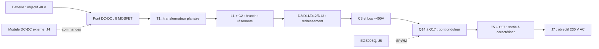

# Comprendre le fonctionnement

[Sommaire](README.md) · [Connectique](02-connectique.md)

## Le problème à résoudre

Une batterie fournit du **courant continu** : sa polarité ne change pas. Les appareils visés attendent une tension **alternative** dont la valeur suit une sinusoïde. À 50 Hz, un cycle dure 20 ms. Une sortie de 230 V efficace atteint environ `230 × √2 = 325 V` en crête.

On ne peut donc pas obtenir cette tension avec un simple interrupteur branché sur 48 V. Le design utilise deux conversions : d'abord élever la tension en continu, puis créer une sinusoïde.



Ce diagramme décrit la fonction prévue. Les [anomalies de la révision](07-audit-technique.md) empêchent d'en déduire un fonctionnement validé.

## 1. Le pont DC-DC

Les transistors Q1/Q2 et Q4/Q5 forment un premier bras, Q6/Q8 et Q7/Q9 le second. Les transistors sont montés par paires en parallèle : ils partagent une commande et le courant du même interrupteur.

Le transformateur reçoit alternativement une polarité puis l'autre entre T1-1 (`IN_DRV2_N`) et T1-2 (`IN_DRV1_N`). Les nets nommés `IN_DRV*_N` sont ici des **nœuds de commutation**, pas une masse ni un signal numérique basse tension. Les résistances de 10 Ω et les diodes associées agissent sur la charge et la décharge des grilles. Les résistances de 10 kΩ maintiennent les grilles référencées à leur source.

Un bras ne doit pas conduire simultanément par son transistor du haut et celui du bas : cela court-circuite la batterie. Le **temps mort** est le bref intervalle pendant lequel les deux commandes sont arrêtées.

## 2. Le transformateur planaire T1

Les enroulements sont dessinés dans un PCB de huit couches. T1 possède, dans le schéma principal, un primaire et deux secondaires : l'un alimente la conversion de puissance, l'autre les auxiliaires du côté haute tension.

Le rapport de tension dépend notamment du rapport de spires. Le noyau ferrite guide le flux magnétique. Il faut connaître le noyau, le matériau, les spires et l'assemblage pour vérifier la saturation, les pertes et l'isolation. **Le seul PCB planaire ne définit pas un transformateur reproductible.**

Le PCB planaire publié n'a pas de schéma, et ses pistes ne sont pas affectées à des nets. Ses six pastilles portent les numéros 1, 3, 6, 8, 15 et 16. Il n'existe pas de correspondance publiée avec les bornes 1 à 6 du symbole T1. Ne pas choisir cette correspondance à partir de la seule position des pastilles.

## 3. La branche résonante L1/C2

Le secondaire de puissance suit ce chemin dans la netliste :

```text
T1-3 → L1 → primaire du capteur de courant T4 → C2 → pont de diodes
T1-4 → autre entrée du pont de diodes
```

Une inductance stocke de l'énergie dans un champ magnétique. Un condensateur la stocke dans un champ électrique. Ensemble, ils échangent cette énergie à une fréquence propre, comme un système ressort/masse. Si la commutation est correctement accordée, le courant peut revenir près de zéro au moment voulu, ce qui réduit certaines pertes de commutation.

La présence de L1/C2 ne suffit pas à garantir une commutation douce. Les inductances de fuite, les tolérances, la charge et les temps morts modifient les formes d'onde. Le [guide DC-DC](03-reglage-dcdc.md) explique ce qu'il faut calculer puis mesurer.

L1 est écrite `22uF` dans les fichiers, une unité de capacité incompatible avec une inductance. Son identifiant de composant renvoie à une SMMS1770-330M de 33 µH. L'écart doit être résolu avant de fixer une fréquence.

## 4. Le bus continu haute tension

D3, D11, D12 et D13 forment le redresseur. C3 stocke et lisse l'énergie reçue. Le schéma ne donne pas la capacité de C3 dans sa valeur ; il indique un champ de tenue à 450 V et une référence d'achat. Le courant d'ondulation et les conditions thermiques restent à vérifier.

Le nom `+400V` exprime une intention. Il n'est ni une mesure ni une consigne garantie. Une tension suffisante au bus permet au second pont de produire la crête de 325 V demandée, avec une marge pour les pertes et la modulation.

U2 (TL431), R35/R36/R37/R38 et U1 (optocoupleur) sont prévus pour limiter le bus avec un retour isolé vers le contrôleur DC-DC. Dans cette révision, `400V` et `+400V` sont deux nets différents. **Cette boucle ne peut pas être considérée opérationnelle.**

## 5. Les alimentations auxiliaires

| Circuit | Entrée | Sortie prévue dans les noms de nets | Calcul des résistances |
| --- | --- | --- | --- |
| U3, L2, D19 | Batterie, GND1 | `+12V` | Environ 12,09 V |
| D25 à D28, U4, L3, D23 | Secondaire auxiliaire, GND2 | `+15V` | Environ 12,09 V |
| U6, L7805 | Rail nommé `+15V`, GND2 | `+5V` | Régulateur fixe 5 V |

Les deux LM5013 ont le même diviseur `453 kΩ / 49,9 kΩ`. Avec leur référence de 1,2 V :

```text
Vsortie ≈ 1,2 × (1 + 453 / 49,9) = 12,09 V
```

Ce calcul suppose un circuit fonctionnel et suffisamment de tension en entrée. Il ne tient pas compte des défauts de cuivre identifiés autour d'U4. Le fait que le rail secondaire soit nommé 15 V ne justifie pas de modifier une résistance sans vérifier les besoins de l'EGS005Q et des GaN. [Notice TI LM5013](https://www.ti.com/lit/ds/symlink/lm5013.pdf).

## 6. Le pont onduleur et la sinusoïde

Q14/Q15 forment le bras associé au pilote 2, Q16/Q17 le bras associé au pilote 1. Ce sont des CID12N65D avec pilote intégré. Leur entrée `PWM` est une entrée logique ; ce composant ne doit pas être remplacé par un transistor GaN nu sur la seule base de sa tension nominale. [Notice Tokmas](https://xonstorage.blob.core.windows.net/pdf/tokmas_cid12n65dtokmas_apr22_xonlink.pdf).

La **SPWM** fait varier la durée des impulsions pour que leur valeur moyenne suive une sinusoïde. Une porteuse rapide effectue le découpage ; la fréquence 50/60 Hz décrit la sinusoïde de sortie. Pour l'EG8025, la porteuse nominale est 20 kHz. [Notice EG8025, §8.1](08-sources.md#eg8025).

T5 est associé à une self de mode commun PDMCAT18107-202ML, puis C57 est placé entre les deux fils de sortie. Une self de mode commun peut avoir une faible inductance en mode différentiel. Sa valeur annoncée de 2 mH ne peut donc pas être utilisée directement comme inductance de filtrage SPWM : il faut vérifier les polarités et mesurer l'inductance différentielle. [Notice du fabricant PROD Tech, p. 11](https://datasheet.lcsc.com/datasheet/pdf/0494e4526be3390a1f5969b85c025245.pdf?productCode=C2943063).

## 7. Mesures et protections

- **T4 et R25** : courant de la branche résonante, redressé par D18/D20/D21/D22 vers IFB du DC-DC.
- **R57/R58** : shunts côté interrupteurs hauts, reliés aux entrées nommées DESAT/SDH.
- **R59/R60 et R52** : mesures de courant côté bas. Leur câblage et les références SGND/PGND doivent être examinés ensemble.
- **TH4** : température du DC-DC via J4. **TH2/TH3** : températures via J5.
- **OUT_P/OUT_N et J5-1** : retours tension AC et bus vers EGS005Q.

Les protections ne sont effectives que si les capteurs, les références de masse, les seuils et le mode de fonctionnement sont corrects. Leur présence sur un schéma ne remplace pas un essai de déclenchement.

## 8. Les trois masses

**GND1** est le retour batterie/DC-DC. **GND2** est le retour du bus et de l'onduleur. **GND3** est la troisième borne de J7, reliée capacitivement aux autres domaines par les condensateurs de 680 pF.

GND3 n'est pas démontrée comme une terre de protection dans le dossier. Les condensateurs qui traversent les domaines doivent être spécifiés pour cette fonction et leurs courants de fuite évalués. Ne pas réunir les trois masses pour « simplifier » les mesures : cela modifierait l'isolation et le fonctionnement.

## Ordres de grandeur

À 1 kW, le courant de sortie idéal est `1000 / 230 ≈ 4,35 A`. À 48 V et avec un rendement **hypothétique** de 90 %, le courant batterie serait `1000 / (48 × 0,90) ≈ 23,1 A`. Ce sont des exemples de dimensionnement, pas les performances mesurées de la carte.

Une batterie de 1 kWh alimentant une charge de 1 kW ne garantit pas une heure d'autonomie : pertes, énergie réellement utilisable et coupure du BMS interviennent.
