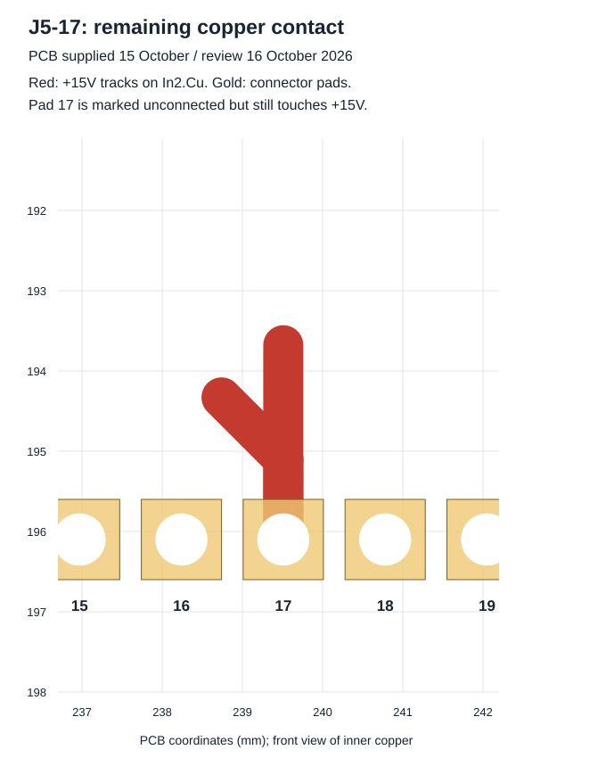

# Revue des corrections du 16 octobre 2026

[Sommaire](README.md) · [Connectique actuelle](02-connectique.md) · [Audit historique du 14 octobre](07-audit-technique.md)

**Conclusion : corrections partielles ; révision non approuvée pour fabrication ou mise sous tension.** Les nouvelles sources sont publiées pour poursuivre la revue. Les points non résolus restent ouverts.

**English summary:** Q15 source/driver references now share a net and IFBCOM is connected, but J5-17 still physically touches +15V copper on In2.Cu. The bus-feedback divider remains disconnected from +400V, current-sense topology has changed, and the Gerber package is incomplete. The strengthened PCB check reports 35 errors. This is not a validated manufacturing release.

## Version examinée et périmètre

Le ZIP `cirBATTverter_1KWH.zip` fourni contient un schéma, un PCB et un projet principal enregistrés le **15 octobre 2026**, ainsi qu'une nouvelle archive Gerber. Les fichiers actifs ont été extraits sans importer `.history`, ses dépôts Git imbriqués, sauvegardes, états d'éditeur ou verrous. Le SHA-256 du ZIP et ceux des fichiers retenus figurent dans [input-manifest.json](reports/2026-10-16/input-manifest.json).

Le PCB planaire n'est pas fourni dans ce ZIP : la version précédente est conservée et reste non qualifiée. La BOM et la CPL fournies sont identiques aux précédentes. Les tables de bibliothèques relatives et les modèles déjà publiés sont conservés. Les fins de ligne des fichiers texte sont normalisées en LF pour Git ; les empreintes brutes d'entrée restent dans le manifeste d'import. Aucun circuit n'a été corrigé automatiquement par cette revue.

Contrôles : export de netliste, comparaison des broches des **160 composants** entre schéma et PCB, examen des changements, ERC, DRC/parité, contrôle renforcé sur copie, inventaire des Gerbers et nouveaux exports de lecture. Outil : **KiCad CLI 10.0.5**. Les valeurs des sources, les constats logiciels et les résultats de banc sont distingués ; aucun essai physique n'a été réalisé.

## Résultats des corrections

| Point | Constat sur le ZIP reçu | Statut |
| --- | --- | --- |
| A01 — J5-17 / EGS005Q | Le net +15V est retiré du pad dans le schéma et dans ses attributs PCB, mais deux pistes +15V touchent toujours le pad en In2.Cu | **Ouvert : court-circuit physique persistant** |
| A02 — IFBCOM | J5-26 rejoint ISENSE1_N, au-dessus de R52 = 10 mΩ | Raccordement présent ; seuil, polarité, filtrage et déclenchement **à valider** |
| A03 — retour bus | R35-1 reste seule sur `/400V`, distinct de `/+400V` | **Ouvert : diviseur non relié au bus** |
| A04 — contacts U4-FB / +15V | Les trois contacts signalés précédemment ne sont plus retrouvés par le contrôle renforcé courant | Constat amélioré ; alimentation et régulation non qualifiées |
| A05 — auxiliaire | R48 = 453 kΩ et R49 = 49,9 kΩ inchangées : cible idéale ≈12,09 V | Nom +15V et marges à confirmer par mesure |
| A06 — référence Q15 | Q15-7/11/12 rejoignent maintenant ISENSE1_P | Incohérence de référence supprimée ; topologie de courant modifiée, voir ci-dessous |
| NC J5 | 13 et 22 laissées ouvertes ; 18 reste sur GND2 ; 17 marquée non connectée | Dégagement à revoir ; le défaut cuivre de 17 demeure |
| FAN1 / empreinte | Champ LCSC PCB aligné avec le schéma | Ancienne différence de champ supprimée ; capacité de ventilation à valider |
| F01 — Gerbers | Toujours absents : B.Cu, F.Mask, B.Mask | **Ouvert : dossier quatre couches incomplet** |
| F02 — cuivre | Empilage principal et gbrjob toujours à 35 µm | Écart avec l'ancienne intention de 70 µm non arbitré |
| F03 — L1 | Valeur toujours `22uF`, référence C2976970 | Unité/valeur à corriger et inductance à mesurer |
| Magnétique / filtre / isolation | Pas de nouveau dossier de noyau, de spires, de filtre ou d'essais | **Ouverts** |

### J5-17 : le net déclaré ne supprime pas le cuivre

Le pad 17 de J5 se trouve à **x = 239,51 mm, y = 196,10 mm**. Le module EGS005Q y présente GND2, selon le connecteur P3 du schéma fabricant déjà vérifié. Le PCB reçu conserve deux segments +15V en **In2.Cu** touchant cette pastille métallisée :

- segment de 1 mm, UUID `8adb836a-a04d-4a1b-8226-f503dab5efde` ;
- segment de 2,42 mm, UUID `3e041d9b-3752-4af0-9905-5517f8b0562d`.

Le [rapport renforcé](reports/2026-10-16/drc-inverter-clearance-enabled.json) signale les deux occurrences `shorting_items`. **Insérer le module peut encore court-circuiter +15V vers GND2.** Il faut éliminer la liaison cuivre réelle avec +15V, définir le raccordement GND2 attendu, recalculer les zones et refaire les contrôles. Une nouvelle étiquette ou un marqueur « non connecté » ne suffit pas ; ne pas relier le pad à GND2 en laissant les pistes +15V en contact.

### Mesure du courant après la correction Q15

Dans les nets actuels, les sources Q15 et Q17, les références SGND/PGND des deux pilotes et J5-15/J5-24 rejoignent **ISENSE1_P**. R59 et R60, chacune de **10 mΩ**, relient toutes deux ISENSE1_P à ISENSE1_N : elles sont maintenant **en parallèle**, soit **5 mΩ idéaux**. Les entrées IFB1 et IFB2 reçoivent donc la même tension différentielle de shunt, et ne disposent plus de deux mesures indépendantes par bras.

R52 = 10 mΩ relie ensuite ISENSE1_N à GND2 ; J5-26/IFBCOM est branchée sur son côté ISENSE1_N. Pour un courant qui traverse effectivement ces résistances, les tensions idéales sont `VIFB1 = VIFB2 = I × 0,005 Ω` et `VIFBCOM = I_R52 × 0,010 Ω`. Ce ne sont pas des consignes de courant ni une équivalence directe au courant AC efficace : chemin du courant, recirculation, C50, dynamique et instant d'échantillonnage interviennent.

La cohérence du nouveau montage doit être revue avec les fonctions du module et ses paramètres. Documenter gains, polarités, seuils, délais, retour Kelvin et comportement sous charges réactives. Valider aussi les niveaux PWM par rapport aux références locales des pilotes. La disparition du défaut de référence de Q15 ne qualifie pas automatiquement cette nouvelle mesure.

### Limitation du bus toujours ouverte

`/400V` n'a que R35-1 dans la netliste ; le bus C3/J5-1/drains hauts est `/+400V`. La suppression du nom VFB côté primaire a seulement renommé le net en `Net-(J4-Pin_5)` : U1-3, C7-1, R32-2 et J4-5 restent raccordés entre eux. Cela ne répare pas l'entrée du diviseur haute tension.

## Contrôles KiCad et leurs limites

| Contrôle du 16 octobre | Résultat |
| --- | --- |
| Netliste / pads des 160 composants électriques | Aucun écart de net retrouvé ; les pads supplémentaires sont traités par la parité |
| ERC courant | **201 signalements : 7 erreurs et 194 avertissements** |
| Détail ERC | 6 alimentations non déclarées pilotées, 1 conflit de types Q13/U3, 1 label 400V isolé, 2 noms multiples de mesure courant ; 191 avertissements de bibliothèques indisponibles dans cet environnement |
| DRC avec réglages fournis | 0 violation et 0 liaison manquante, **17 avertissements de parité** |
| DRC sur copie avec clearance, hole_clearance et annular_width activés | **35 erreurs : 2 contacts entre nets, 17 espacements, 16 anneaux** ; 17 parités supplémentaires |
| DRC planaire conservé | **40 erreurs et 10 avertissements**, PCB inchangé |

Le projet reçu ignore toujours `clearance`, `hole_clearance` et `annular_width`. Il ignore aussi six familles qui étaient auparavant averties : `isolated_copper`, `lib_footprint_issues`, `lib_footprint_mismatch`, `silk_over_copper`, `silk_overlap`, `via_dangling`. Le zéro du contrôle courant n'est donc pas un contrôle complet réussi. Les 35 erreurs sont des occurrences du logiciel, pas 35 défauts électriques indépendants : certaines concernent les mêmes géométries de pads thermiques.

Les 17 parités restantes concernent 8 duplications de `REF**` et 9 empreintes mécaniques supplémentaires. Les pads thermiques U4 10–17 n'ont plus de net ; cela fait disparaître l'ancien écart de parité, mais ne démontre pas la correction de leur représentation. Les 16 erreurs d'anneaux concernent les perçages des empreintes U3/U4 ; les espacements autour de ces perçages doivent être examinés avec la géométrie réelle et les capacités du fabricant.

**Limite de l'environnement :** les catalogues standard installés ne sont pas lisibles pendant ce contrôle. Les 191 avertissements ERC correspondants sont conservés et identifiés ; ils ne doivent ni être présentés comme 191 nouvelles erreurs du circuit, ni être supprimés pour annoncer un ERC réussi. Les comparaisons aux bibliothèques standard doivent être refaites sur une installation complètement accessible. Les logs mentionnent aussi les accès registre/configuration refusés. La netliste et les rapports ont été produits, mais cela ne constitue pas une qualification électrique ou thermique.

Les exports SVG actuels du schéma et du PCB ont été renouvelés. Les rapports du 14 octobre restent historiques ; ils ne décrivent pas le cuivre de cette révision.

## Étapes restantes

1. Corriger réellement le cuivre de J5-17 et le retour R35/+400V, puis exécuter les contrôles avec les espacements actifs.
2. Revoir et valider la mesure commune R59/R60/R52 et les protections IFB/IFBCOM de l'EGS005Q.
3. Examiner les anneaux/perçages et la représentation thermique U3/U4, puis justifier chaque exclusion éventuelle.
4. Compléter le transformateur, L1, T5, C3, l'isolation, le refroidissement et la plage batterie ; fournir des mesures et une fréquence DC-DC validée.
5. Après revue, regénérer ensemble les quatre couches cuivre, les deux masques, les perçages et les documents d'assemblage de la même révision.

Pour les projets de batteries de seconde vie liés à ce convertisseur, voir le [guide batterie/BMS](09-batteries-seconde-vie.md) et [cirBATT](https://cirbatt.com/). Ces corrections ne constituent pas une validation de compatibilité d'un pack commercial.
