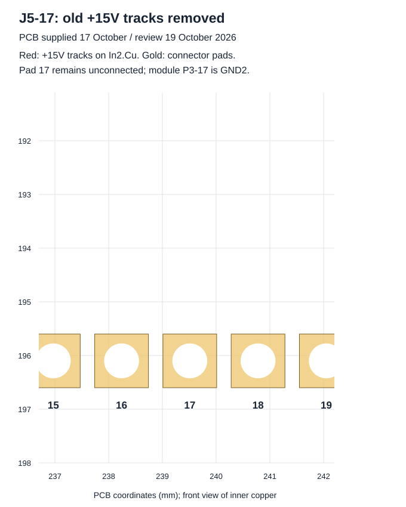

# Revue des corrections du 19 octobre 2026

**Document historique :** les sources du 20 octobre corrigent ensuite la référence de Q15 et ses découplages. Consulter la [revue actuelle](12-revue-corrections-2026-10-20.md). Les constats ci-dessous décrivent les sources du 17 octobre.

[Sommaire](README.md) · [Connectique actuelle](02-connectique.md) · [Révision précédente](10-revue-corrections-2026-10-16.md)

**Conclusion : progrès confirmés ; révision encore non approuvée pour fabrication ou mise sous tension.** Les anciennes pistes +15V de J5-17 sont supprimées, R35 rejoint +400V et les couches Gerber manquantes sont présentes. La référence du pilote Q15 reste toutefois à corriger ou justifier, et les vérifications PCB ne passent pas avec les espacements actifs. Les points non résolus restent ouverts.

**English summary:** the J5-17 supply contacts have been removed, R35 now joins +400V, and the Gerbers include four copper layers and both masks. Separate 10 mΩ leg shunts have been restored. However, Q15 source is on ISENSE3_P while its SGND/PGND remain on ISENSE1_P. Strengthened DRC reports 33 errors; ERC reports 7 errors and 11 warnings. This is not a manufacturing release.

## Sources et méthode

Archive reçue le **19 octobre 2026**, fichiers principaux enregistrés le **17 octobre**. Son SHA-256 et les empreintes brutes des 22 fichiers retenus sont conservés dans le [manifeste d'import](reports/2026-10-19/input-manifest.json). Seuls le schéma, le PCB, le projet principal et le Gerber ZIP ont changé par rapport à la branche de revue `8686bb68babf5e142b5b482a8a3aa163c82f589e`. Les bibliothèques relatives, modèles, BOM/CPL et le planaire sont conservés. Le ZIP ne fournit pas de nouveau PCB planaire. Aucun circuit n'a été corrigé automatiquement pendant la revue.

Contrôles KiCad CLI **10.0.5** : netliste native, comparaison des broches des 160 composants électriques avec les pads PCB, ERC, DRC/parité aux règles fournies et avec trois règles réactivées sur une copie, examen des changements et inventaire Gerber. Les exports SVG sont renouvelés. L'historique d'éditeur, les dépôts Git imbriqués et les états/verrous ne sont pas importés. Les textes publiés utilisent LF ; le manifeste d'import conserve les empreintes originales. Aucun essai sur carte physique n'a été effectué.

## Résultat des corrections

| Point | Révision du 17 octobre, revue le 19 | État |
| --- | --- | --- |
| A01 — J5-17 | Les deux segments +15V précédemment en contact sont supprimés ; aucun `shorting_items` dans le DRC renforcé | **Ancien court-circuit supprimé dans les fichiers** ; pad toujours NC, module P3-17 = GND2 |
| A02 — IFBCOM | J5-26 reste reliée à ISENSE1_N, côté haut de R52 = 10 mΩ | Raccordement présent ; seuil, polarité et dynamique à valider |
| A03 — retour bus | R35-1 appartient maintenant à /+400V dans netliste et PCB ; plus de label /400V isolé | **Connexion corrigée** ; régulation et consigne restent à mesurer |
| A04 — U4-FB | Aucun contact avec +15V retrouvé dans le DRC renforcé | Ancien contact non retrouvé ; alimentation non qualifiée |
| A05 — auxiliaire | R48 = 453 kΩ, R49 = 49,9 kΩ, soit environ 12,09 V idéaux | Tension réelle, démarrage et marges des pilotes à mesurer |
| A06 — Q15 | Source 12 sur ISENSE3_P ; SGND 7 et PGND 11 sur ISENSE1_P | **Ouvert : référence du pilote sur le net de l'autre bras** |
| Mesure par bras | R59 = 10 mΩ sur ISENSE3_P ; R60 = 10 mΩ sur ISENSE1_P ; côtés bas communs | Deux mesures rétablies ; ancienne description parallèle 5 mΩ devenue historique |
| F01 — Gerbers | F.Cu, In1.Cu, In2.Cu, B.Cu, F.Mask, B.Mask, profil et deux perçages présents | **Anciennes couches manquantes ajoutées** ; dossier toujours non approuvé |
| F02 — cuivre | PCB et gbrjob déclarent 35 µm par couche | Ancienne intention 70 µm non arbitrée |
| F03 — L1 | Toujours notée 22uF, référence C2976970 | Valeur/unité, caractérisation et résonance à établir |
| Magnétique, filtre, isolation | Pas de nouvelles mesures ni de dossier magnétique complet | **Ouverts** |

## J5-17 : ancien contact supprimé

Les UUID `8adb836a-a04d-4a1b-8226-f503dab5efde` et `3e041d9b-3752-4af0-9905-5517f8b0562d` ne sont plus présents dans le PCB. Le DRC renforcé ne signale plus les deux courts-circuits. La pastille reste au même emplacement, x = 239,51 mm et y = 196,10 mm, sur le net `unconnected-(J5-Pin_17-Pad17)`.

Le module fournit GND2 à cette position ; la carte ne raccorde pas cette pastille, tandis que J5-3 et J5-27 sont sur GND2. Ce constat ne justifie plus d'annoncer le court-circuit +15V de la révision précédente. La distribution des retours et le découplage restent à vérifier avec les courants et le montage réel du module. La vue ci-dessous montre les segments locaux ; le DRC examine aussi le reste du cuivre.

## Q15 et mesure du courant : point encore ouvert

La séparation des mesures a été rétablie :

- Q15-12/S → ISENSE3_P → R59 de 10 mΩ → ISENSE1_N ; J5-15/IFB2P mesure ISENSE3_P.
- Q17-12/S → ISENSE1_P → R60 de 10 mΩ → ISENSE1_N ; J5-24/IFB1P mesure ISENSE1_P.
- J5-16/IFB2N et J5-25/IFB1N rejoignent ISENSE1_N ; R52 de 10 mΩ relie ce nœud à GND2 et J5-26/IFBCOM s'y raccorde.

**R59 et R60 ne sont donc plus en parallèle.** Pour les courants qui traversent effectivement ces résistances : `VIFB2 = I_R59 × 0,010 Ω`, `VIFB1 = I_R60 × 0,010 Ω`, `VIFBCOM = I_R52 × 0,010 Ω`. Ce ne sont ni des seuils qualifiés, ni une conversion directe du courant AC efficace. Le chemin de recirculation, C50, les filtres, les gains, les polarités et l'instant de mesure interviennent.

Cependant Q15-7/SGND et Q15-11/PGND sont restées sur **ISENSE1_P**, le nœud source de Q17, alors que Q15-12/S est sur **ISENSE3_P**. Cette différence est présente à la fois dans le schéma et le PCB ; une simple synchronisation entre eux ne la détecte donc pas. Examiner la fiche du CID12N65D et les retours locaux du pilote, puis corriger la connexion ou documenter précisément son intention et ses marges. Ne pas réunir arbitrairement les deux nœuds de mesure : cela remettrait R59/R60 en parallèle. Vérifier également la référence des niveaux PWM et le raccordement Kelvin avant de définir les protections.

## Retour du bus

R35-1 rejoint désormais le même /+400V que C3/J5-1. Le défaut de raccordement identifié précédemment est supprimé. Le calcul idéal de la chaîne TL431 ne constitue toujours pas une consigne validée : vérifier tolérances, tenue en tension des résistances, polarité de la boucle optocoupleur, dynamique, démarrage et arrêt avant qualification. Le retour côté primaire reste `Net-(J4-Pin_5)` vers U1-3/C7-1/R32-2/J4-5.

## Contrôles actuels

| Contrôle | Résultat |
| --- | --- |
| Netliste / PCB | **0 écart de net**, 160 composants électriques comparés |
| ERC | **7 erreurs et 11 avertissements**, soit 18 signalements |
| Détail ERC | 6 alimentations non déclarées pilotées ; conflit Q13/U3 ; 10 écarts au symbole Device:D et 1 nom multiple ISENSE1_N/ISENSE3_N |
| DRC aux règles fournies | 0 violation, 0 liaison manquante ; **17 avertissements de parité** |
| DRC renforcé sur copie | **33 erreurs : 17 espacements et 16 anneaux** ; 0 court-circuit signalé ; 17 parités |
| Planaire | Sources inchangées ; résultat historique conservé : 40 erreurs et 10 avertissements |

Les catalogues standard sont accessibles pendant cette exécution : les 191 avertissements d'accès de la revue du 16 octobre ne sont pas présents. Leur disparition reflète l'environnement de contrôle, pas 191 corrections du circuit. Les dix différences du symbole de diode concernent D3, D11, D12, D13, D19, D23, D25, D26, D27 et D28 ; comparer la copie intégrée au symbole de bibliothèque et vérifier broches, sens et empreintes avant toute mise à jour. L'ERC conserve ses erreurs : aucun ERC réussi n'est revendiqué. Les messages de refus d'accès registre KiCad restent dans les logs de travail ; les exports et rapports ont été produits.

Les règles `clearance`, `hole_clearance` et `annular_width` restent ignorées dans le projet reçu, ainsi que douze autres familles. La copie renforcée active uniquement ces trois règles ; ce n'est pas une vérification exhaustive d'isolation haute tension. Les 17 espacements comprennent un écart DESAT1_P / via OUT_HS1_N à environ **0,1928 mm pour 0,2000 mm demandés**, et 16 occurrences autour des pads thermiques U3/U4. Les 16 anneaux concernent les perçages thermiques U3/U4. Certaines descriptions de ces géométries thermiques donnent une distance supérieure au seuil tout en signalant une violation : examiner la représentation exacte et les contraintes du fabricant ; ne pas les compter comme autant de défauts fonctionnels indépendants ni les supprimer sans justification.

Les 17 parités concernent huit duplications REF** et neuf empreintes mécaniques supplémentaires. Les exclusions de contrôle des bibliothèques/empreintes restent à revoir. Les rapports natifs sont disponibles dans le [dossier daté](reports/README.md).

## Fabrication et suite

Le ZIP Gerber reçu contient 14 fichiers : onze Gerbers, un gbrjob, PTH et NPTH. L'ajout des couches manquantes corrige la complétude de cet inventaire ; il ne démontre pas à lui seul la conformité de chaque tracé à une future révision approuvée. Le gbrjob indique un export KiCad 10.0.4 du 17 octobre et quatre couches à 35 µm. BOM/CPL restent anciennes. Après les dernières corrections, regénérer et vérifier ensemble Gerbers, perçages, BOM et CPL depuis le même commit.

1. Corriger ou justifier les références SGND/PGND de Q15, puis contrôler la mesure de chaque bras et IFBCOM.
2. Traiter les espacements, anneaux, parités et erreurs ERC ; justifier individuellement les exclusions retenues.
3. Valider l'auxiliaire, la boucle bus, les protections, la fréquence DC-DC, L1, le noyau/planaire, T5/C57, C3, l'isolation et le refroidissement.
4. Compléter le dossier système et les mesures de banc avant de publier une version destinée à la fabrication.

Pour le pack et son BMS, consulter le [guide batterie](09-batteries-seconde-vie.md) et les ressources [cirBATT](https://cirbatt.com/). La PR reste ouverte tant que ces points ne sont pas résolus.
